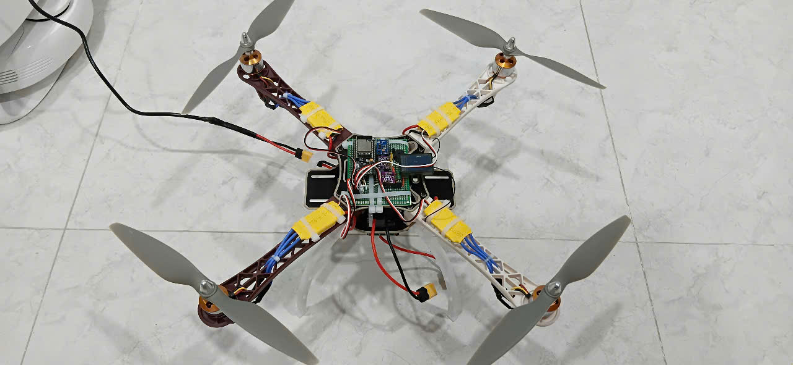

# 🚁 Dự Án ESP32_F450_DRONE

Đây là một dự án drone DIY sử dụng **ESP32** làm flight controller, kết nối với các cảm biến và thiết bị điện tử cơ bản, chạy firmware **ESP-FC** và có thể **tune thông số bay qua Betaflight**.
---

## 🧩 Thành phần phần cứng

| Thành phần                 | Thông tin chi tiết |
|---------------------------|---------------------|
| MCU (bộ điều khiển chính) | ESP32               |
| Cảm biến IMU              | BMI160 (gyro + accel) |
| Cảm biến khí áp           | BMP280              |
| Cảm biến từ trường + gia tốc | GY-511 (LSM303DLHC) |
| Buzzer                    | Kết nối qua BJT C1815 |
| ESC                       | 4x ESC XXD 30A       |
| Động cơ                   | 4x Motor 2212 1000KV |
| Cánh quạt                 | 1045                |
| Pin                       | Gói pin 3S3P Li-ion VTC6 |
| Firmware có thể tham khảo | [ESP-FC](https://github.com/rtlopez/esp-fc) |
| Giao diện tinh chỉnh      | Betaflight Configurator |

---

## ⚙️ Kết nối phần cứng

### I2C:
- BMI160: SDA, SCL
- BMP280: SDA, SCL
- GY-511 (LSM303DLHC): SDA, SCL *(chia sẻ chung bus I2C)*

### PWM (Tín hiệu điều khiển động cơ):
- 4 ESC được nối vào các chân PWM của ESP32 (ví dụ: GPIO 15, 2, 0, 4)

### Buzzer:
- Kết nối thông qua transistor NPN C1815 với GPIO (ví dụ: GPIO 23)

### Pin:
- Gói pin 3S3P Li-ion VTC6 cấp nguồn cho ESC và ESP32 (thông qua mạch ổn áp nếu cần)

